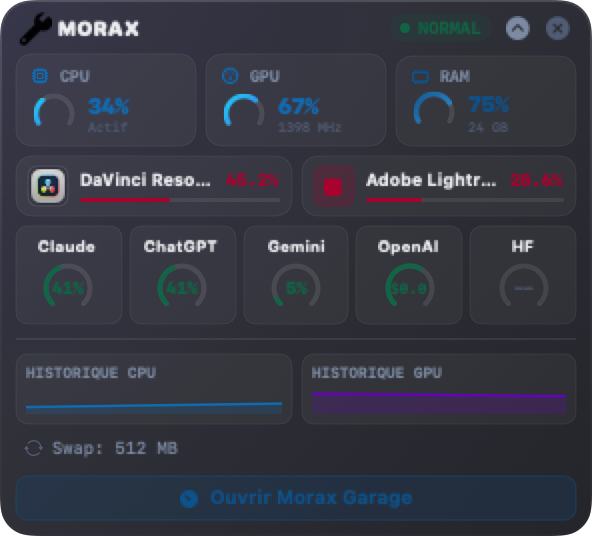
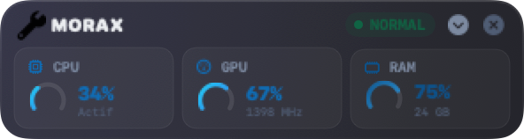

<p align="center">
  
</p>

<h1 align="center">Morax Garage</h1>

<p align="center">
  A native macOS cockpit for system telemetry, safe disk cleanup of creative-work caches, and AI API usage.
</p>

Morax Garage is a SwiftUI app for macOS 14+ that shows what your Mac is doing (CPU, GPU, memory pressure, disk, network, temperatures) and helps you reclaim disk space from DaVinci Resolve, Lightroom, Capture One and developer build artefacts. Every deletion goes through a safety layer and moves files to the Trash instead of removing them. A menu bar companion shows a compact "mini cockpit" at a glance.

<p align="center">
  
  
</p>

## Features

- **Live telemetry dashboard**: CPU (per-cluster topology), GPU, real memory pressure (`kern.memorystatus_level`), swap, disk volumes, network throughput, temperatures and top resource-consuming apps, rendered as automotive-style gauges with short in-memory history. Apple Silicon sensors are read through [macmon](https://github.com/vladkens/macmon) when available, with a Darwin fallback.
- **Cleanup and cache**: scanners for DaVinci Resolve (render cache, optimised media, proxies, gallery stills, logs), Lightroom and Capture One caches, developer artefacts (`node_modules`, build output, Rust `target`, Python virtualenvs, Xcode DerivedData), app and browser caches, installers (`.dmg`, `.pkg`), and Claude Code leftovers. Items are classified by risk tier: safe, rebuild cost, destructive, blocked.
- **SafetyGate**: every candidate path is checked before it can be touched. It refuses denylisted system paths, the home and filesystem roots, symlinks that escape the scan root, Resolve project data, photo-app master data, and cloud-synced containers, and it enforces item-count and batch-size caps. Cleanup moves items to the Trash through a staging service.
- **Storage map**: treemap view of where disk space goes, with an inspector.
- **AI API usage monitoring**: Higgsfield credit gauge (via the `higgsfield` CLI), Meta Muse session token usage (via the `muse` CLI and local logs), OpenAI organisation costs (admin API key stored in the Keychain), and optional Claude/Codex quota cards fed by a self-hosted endpoint you configure.
- **AI models inventory**: lists locally installed model files and lets you uninstall them.
- **Photo sync**: tracks photo projects across Mac, SSD and NAS and copies them with `rsync`.
- **Menu bar mini cockpit**: a separate helper app (`Morax Garage Menu`) with a compact Liquid-Glass HUD and configurable menu bar readouts (RAM, network, disk, temperature, swap alert).
- **Extras**: persistence audit (launch agents and login items), installed applications view, environment view, Homebrew view, an embedded terminal for the [Mole](https://github.com/tw93/Mole) CLI, a permissions checker (Full Disk Access), and a demo mode with a built-in guide.

## Requirements

- macOS 14 (Sonoma) or later, Apple Silicon or Intel
- To build: Xcode 16 / Swift 6 toolchain

## Install

### a) Download the DMG

Get the latest `.dmg` from [GitHub Releases](https://github.com/Etienne-Morax/morax-garage/releases/latest) and drag **Morax Garage** to Applications.

Unless its release notes say it is notarized, a release is ad-hoc signed and macOS will block the first launch. Right-click the app and choose **Open**, or clear the quarantine flag:

```bash
xattr -dr com.apple.quarantine "/Applications/Morax Garage.app"
```

The app is also available through the Morax One platform download.

### b) One-line install from source

```bash
curl -fsSL https://raw.githubusercontent.com/Etienne-Morax/morax-garage/main/scripts/install-from-source.sh | bash
```

Read the script before piping it to a shell. It needs Xcode 16 or the matching Swift toolchain.

### c) Manual

```bash
git clone https://github.com/Etienne-Morax/morax-garage.git
cd morax-garage
scripts/install.sh
```

This builds universal (`arm64` + `x86_64`) bundles and installs them into `/Applications`.

## Build and test

```bash
swift build            # debug build
swift build -c release # release build
swift test             # unit tests
scripts/build_app.sh   # signed .app bundles in dist/
```

Maintainer release flow (signing, notarization, DMG, manifest): [docs/DISTRIBUTION.md](docs/DISTRIBUTION.md). Architecture notes: [docs/architecture](docs/architecture/).

## Privacy

Telemetry, scans and cleanup history stay on your Mac. Morax Garage has no analytics and no crash reporting. Network access is limited to features you enable:

- **OpenAI costs**: calls `https://api.openai.com/v1/organization/costs` with an admin key you provide, stored in the macOS Keychain.
- **Usage quotas**: calls an endpoint you configure in Settings, sending an internal key (Keychain) in an `X-Internal-Key` header. Only `https` is accepted, or `http` to localhost.
- **Higgsfield and Meta Muse**: read through their own local CLIs; the app makes no direct request.
- **Tool installers**: the Environment view lists install commands for missing tools (for example the official Homebrew installer from `raw.githubusercontent.com`); these are shown to you, not run silently.

Scanning protected folders requires Full Disk Access, which you grant in System Settings. The security review is in [docs/internal/audits/SECURITY_PRIVACY_AUDIT.md](docs/internal/audits/SECURITY_PRIVACY_AUDIT.md). To report a vulnerability see [SECURITY.md](SECURITY.md).

## Contributing

Issues and pull requests are welcome. See [CONTRIBUTING.md](CONTRIBUTING.md) and the [Code of Conduct](CODE_OF_CONDUCT.md).

## License

[MIT](LICENSE) © 2026 Etienne Moreau

## En français

Morax Garage est une application macOS native (macOS 14+) de télémétrie système, de nettoyage sécurisé des caches de travail créatif (DaVinci Resolve, Lightroom, Capture One, artefacts de développement) et de suivi de consommation d'APIs IA. Les suppressions passent par `SafetyGate` et déplacent les fichiers vers la Corbeille. Une app de barre des menus affiche un mini cockpit.

Installation : téléchargez le DMG depuis les [Releases](https://github.com/Etienne-Morax/morax-garage/releases/latest) (non notarisé pour l'instant : clic droit puis Ouvrir, ou `xattr -dr com.apple.quarantine "/Applications/Morax Garage.app"`), ou lancez `scripts/install.sh` après un `git clone`. Compilation : `swift build` ; tests : `swift test`. Licence MIT.
